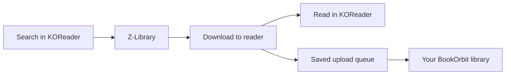

<div align="center">

# Kindle Fetch

**Find a book. Bring it to your reader. Keep reading.**

A Z-Library-only plugin for KOReader, with direct downloads and native networking fixes for Android readers and background uploads to your BookOrbit library.

[](https://github.com/seshakiran/kindlefetch.koplugin/actions/workflows/checks.yml)


[](LICENSE)

[Install](#install) · [Use](#use) · [Troubleshooting](#troubleshooting) · [BookOrbit roadmap](docs/BOOKORBIT_ROADMAP.md)

</div>

## What works today

| Feature | Current behavior |
| --- | --- |
| One source | Searches **[z-library.sk](https://z-library.sk/)**. The Sites menu explicitly says **Z-Library**. |
| Account access | Sign in from the plugin and use the account's download access. |
| Search | Search by text, including author names; apply available language and file-format filters. |
| Direct downloads | Fetch a selected book's download link and save the file to the configured reader folder. |
| Native networking | DNS-over-HTTPS support works through KOReader's HTTP client, including devices without `curl`. |
| Connection recovery | A native search interrupted by a connection-abort error gets one retry with refreshed DNS and a fresh request. |
| Diagnostics | Save a report to help investigate DNS, HTTP-client, and connection failures. |
| BookOrbit uploads | Sign in to your BookOrbit website account, select a library, and upload completed downloads in the background. Existing local books can also be sent manually. |

Other providers are no longer registered or offered in search. Some unused provider modules remain from upstream; they are not active sources. Old saved “All” selections resolve to Z-Library only.



## Install

Requires an existing KOReader installation and an internet connection. This branch was developed and deployed on a **Viwoods AiPaper Mini running Android**. Other KOReader devices have not been verified with this fork.

1. Clone this repository and build the source-only installation package:

   ```sh
   git clone https://github.com/seshakiran/kindlefetch.koplugin.git
   cd kindlefetch.koplugin
   python3 scripts/package.py
   ```

2. Extract `dist/kindlefetch.koplugin.zip`. Copy its `kindlefetch.koplugin` folder into your device's `koreader/plugins/` directory.
3. Confirm the resulting path is `koreader/plugins/kindlefetch.koplugin/main.lua`, with no extra enclosing folder.
4. Fully restart KOReader, then open **Kindle Fetch** from its menu.

**Transferring with OpenMTP:** wake and unlock the reader, connect USB, and explicitly select **File Transfer / MTP** on the device. Refresh OpenMTP, copy the plugin folder, and keep the reader awake until the transfer finishes. Quit KOReader before replacing its plugin files and restart afterward.

The plugin updater now points to this repository. It requires a GitHub Release tagged `v<version>` with an asset named `kindlefetch.koplugin.zip`; ordinary source commits do not become in-app updates. Build from source until a release is published.

## Use

1. Connect the reader to Wi-Fi and open Kindle Fetch.
2. Sign in to Z-Library through the plugin.
3. Enter a title or author name in the search box. Author names use the normal text search; there is no separate author-only filter.
4. Choose a result and download an available format into your configured download folder.
5. Open the downloaded file in KOReader.

Account limits and service availability still apply. Account identifiers and the session key are saved in the reader's local settings; keep device settings private. The login password is not persisted by the account code.

## Troubleshooting

| Symptom | What to check |
| --- | --- |
| “Could not resolve z-library.sk” | Check Wi-Fi and try **Encrypted DNS** in Kindle Fetch settings. Z-Library requests also enable DNS fallback. |
| “curl is not found” | Native HTTP and encrypted DNS support do not require curl. Confirm that this version is installed and KOReader was restarted. |
| TLS/SSL connection failed | Check the device clock, network, and VPN routing; try the same site in the reader's browser. Save diagnostics if it persists. |
| “Software caused connection abort” | Native search retries once. If both attempts fail, check network reachability and save diagnostics. |
| Works with Tailscale off | Compare the reader's DNS and routing with Tailscale enabled and disabled. Turning it off helped during development, but a search abort also occurred with it off. |
| OpenMTP cannot open storage | Unlock the reader, reselect USB File Transfer, reconnect, and refresh OpenMTP. |

Use **Kindle Fetch → Diagnostics → Save** after reproducing a problem. The report is saved as `kindlefetch-diagnostics.txt` in KOReader's data directory. Review reports before sharing; do not publish credentials, session keys, or personal search history.

Network recovery is bounded: the connection-abort retry applies to search, not login or file downloads. DNS fallback preserves the requested hostname and existing TLS configuration. It does not make an unreachable service reachable on every network.

## Development

```sh
# Lua and luac must be installed.
sh scripts/check.sh

# Build the installable ZIP; no accounts, diagnostics, or books are packaged.
python3 scripts/package.py
```

The regression suite uses mocked network and account dependencies. It covers native DNS bootstrap, DNS response validation and caching, timeout restoration, bounded search-abort recovery, optional curl DNS fallback, the fixed Z-Library source/account behavior, BookOrbit session rotation, multipart streaming, and upload queue failure/recovery behavior. CI runs syntax and regression checks on **Lua 5.1 and 5.4** and builds the plugin package.

Local live HTTP checks were also exercised during development. Those checks and the device deployment do not guarantee future Z-Library availability or API compatibility. See [CHANGELOG.md](CHANGELOG.md) for this fork's changes.

## Search from BookOrbit's dashboard

With Kindle Fetch **0.9.1+** and the optional BookOrbit reader search patch installed, tap the dashboard's search icon and enter a title or author:

- **Search library** searches the existing BookOrbit library, preserving its scope and recent searches.
- **Search Z-Library** starts the same Kindle Fetch search and download flow used by the standalone plugin. Its language/format preferences, Z-Library account, DNS fixes, and automatic BookOrbit uploads all apply.

Closing the Kindle Fetch search returns to the BookOrbit catalog underneath. Search results use Kindle Fetch's existing reader UI; this is not a server-side search integration or a web-dashboard change. Both reader plugins must be installed and enabled. Z-Library search is disabled in the BookOrbit dialog when the handoff is unavailable.

The [BookOrbit patch and installation guide](https://github.com/seshakiran/bookorbit-reading-stack/blob/main/docs/PLUGINS.md#search-z-library-from-the-bookorbit-dashboard) cover the reviewed BookOrbit reader plugin **1.5.5**. The patch does not copy account settings or embed credentials. A future BookOrbit plugin update can replace the patched catalog file; reapply only against a supported version.

## Send books to BookOrbit

Open **Kindle Fetch → Settings → BookOrbit uploads**:

1. Choose **Account** and sign in with your **BookOrbit website username and password**. The server URL is filled from the installed BookOrbit plugin when available. Its sync username/key are separate credentials and cannot authorize file uploads.
2. Choose the destination book library.
3. Leave **Upload after download: On** to send new completed downloads automatically. Turn it off to stop automatic queueing/processing; manual uploads remain available.
4. Use **Send an existing book** to browse and queue a book already on the reader.

The upload runs in a subprocess and streams the local file. Originals stay on the reader. The menu shows waiting, uploading, sent, failed, and interrupted states. Waiting jobs resume on startup, wake, and network reconnection. Temporary failures **before** the file POST get up to three attempts with backoff. Interrupted file transfers are held for review because BookOrbit may already have accepted them; check the website before choosing **Retry interrupted uploads**.

### Working Tailscale setup

**Confirmed on the originating Viwoods AiPaper Mini on October 20, 2026:** a book downloaded through Kindle Fetch appeared automatically in BookOrbit after applying this setup:

1. Leave **Tailscale connected** on the reader and BookOrbit server.
2. Set the reader's Tailscale **Exit node** to **None**.
3. Turn off **Use Tailscale DNS** on the reader, if available.
4. Leave Kindle Fetch's **Encrypted DNS** enabled.
5. Keep **Upload after download: On**, with the BookOrbit account and destination library selected.

This lets Z-Library use the normal internet connection while BookOrbit remains reachable through the tailnet. Keep KOReader included in Tailscale: excluding the application also excludes its BookOrbit uploads. The confirmed BookOrbit connection uses a saved numeric tailnet address, so it does not depend on MagicDNS. If your server URL uses a tailnet hostname, check that it still resolves before disabling Tailscale DNS.

No VPN toggle or manual **Send** action was needed in the confirmed download → automatic upload test. This is a user-confirmed result on the original setup, not a guarantee for every VPN, network, or device. See Tailscale's [exit-node behavior](https://tailscale.com/docs/features/exit-nodes), [DNS preferences](https://tailscale.com/docs/features/client/manage-preferences), and [Android app split tunneling](https://tailscale.com/docs/features/client/android-app-split-tunneling).

If the server is unreachable, the local book remains available. Safe preflight failures get up to three attempts; after those fail, restore connectivity and use **Retry waiting/failed uploads**. The plugin does not turn Tailscale on or off.

### Storage and upload confirmation

BookOrbit's native access/refresh session is stored in `kindlefetch_bookorbit.json` in KOReader's settings directory, alongside the persistent queue. The password is not stored. Keep this file private. HTTPS addresses and private LAN/Tailscale HTTP addresses are supported. Upload credentials are never sent to Z-Library or forwarded across redirects.

Successful uploads require the server to return a `bookId`; metadata extraction can continue afterward. Content hashes prevent repeat uploads already recorded by this reader for the same account/library. This is not a global duplicate search of the whole server. A server-side filename conflict is reported for review.

See the [BookOrbit integration notes and remaining roadmap](docs/BOOKORBIT_ROADMAP.md). The companion deployment project is [bookorbit-reading-stack](https://github.com/seshakiran/bookorbit-reading-stack).

## Credits & license

This fork builds on [william-spongberg/KindleFetch.koplugin](https://github.com/william-spongberg/KindleFetch.koplugin), itself derived from [justrals/KindleFetch](https://github.com/justrals/KindleFetch), and runs inside [KOReader](https://github.com/koreader/koreader).

Distributed under the [MIT license](LICENSE), preserving the upstream copyright notice.
