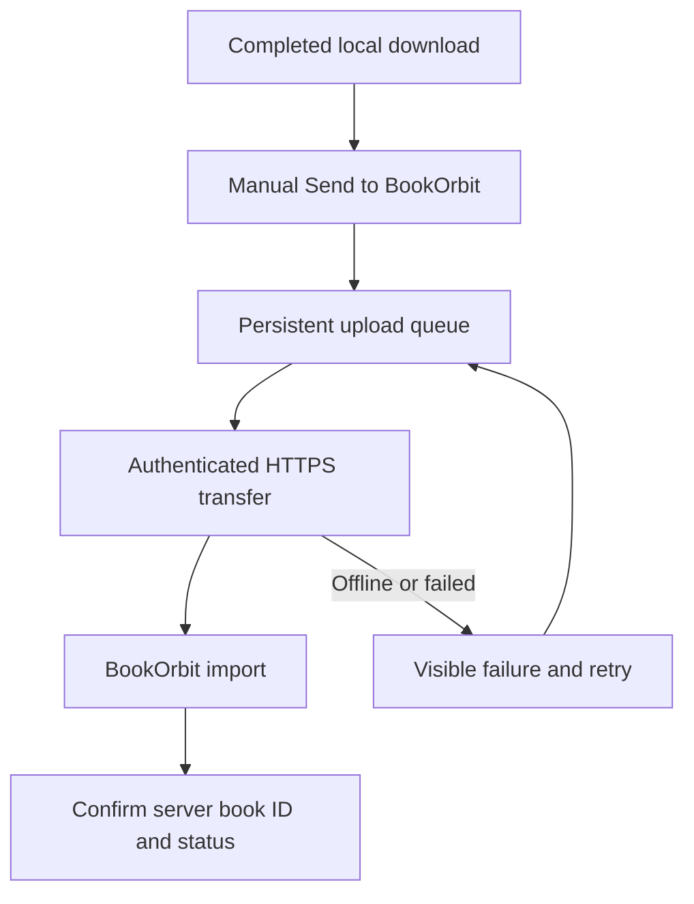

# From reader to BookOrbit

**Status: planned.** The current plugin searches Z-Library and saves files locally. This document defines the next milestone; the plugin does not currently upload books or modify the website.

The destination is the personal BookOrbit deployment associated with [bookorbit-reading-stack](https://github.com/seshakiran/bookorbit-reading-stack). Its exact base URL and deployed import capabilities must be confirmed before implementation.

## Intended experience

After a successful download, choose **Send to BookOrbit**. The plugin queues the local file, sends it through an authenticated connection, and shows whether BookOrbit accepted and imported it. Keep the original file on the reader. A failed upload must not prevent reading locally.

## 1 · Confirm the server contract

- Identify the deployed BookOrbit version, website base URL, and authentication method.
- Verify whether it exposes a supported upload/import API, including request format, size limits, accepted file types, and import-status responses.
- If direct upload is unavailable, evaluate a small authenticated bridge that stages files into a BookOrbit watched media folder. The deployment stack documents watched-folder imports; this still needs verification against the running installation.
- Record the confirmed contract and a small end-to-end import example before building the plugin client. Do not invent an API path or treat file transfer as proof of a completed import.

## 2 · Ship a manual upload

- Add local settings for the BookOrbit base URL and a separate, scoped authentication credential.
- Offer **Send to BookOrbit** only for completed, existing local files.
- Send the file and supported metadata: title, author, format, and source identifier where available.
- Show queued, uploading, imported, and failed states; retain the server's book identifier or import-job identifier.
- Open the resulting BookOrbit book link when the server provides one.

BookOrbit credentials belong in private device settings. Never forward a Z-Library session cookie or account key to BookOrbit. Never commit endpoints containing credentials, tokens, device settings, or downloaded books to this public repository.

## 3 · Make it dependable

- Persist queue state across KOReader restarts and network changes.
- Identify duplicates using a content hash and the server's supported idempotency or lookup mechanism.
- Use bounded retries with backoff for temporary failures; expose authentication and permanent errors for user action.
- Support resumable uploads only if the server explicitly supports them; otherwise retry safely without creating duplicate imports.
- Retain the local original after upload and expose clear retry/cancel controls.
- Test with Tailscale on and off, especially when the personal deployment requires a private network route.

## 4 · Add optional automation

Once manual uploads are reliable, add an opt-in **Upload after download** setting. Keep visible queue status, duplicate protection, and manual retry available. Automatic upload should begin only after a successful local download.

## Acceptance checks

| Scenario | Expected result |
| --- | --- |
| Valid supported book | One imported BookOrbit entry with correct title/author and a readable file. |
| Same file sent twice | Existing entry reused or duplicate explicitly reported. |
| Reader offline | Local book remains usable; pending upload can be retried. |
| Restart while queued/uploading | Queue recovers without silently losing the job or duplicating the import. |
| Expired credential | Clear authentication error; no endless retries. |
| Server rejects format or size | Actionable error; original file retained. |
| Interrupted transfer or import failure | Failure stays visible; transfer success alone is not shown as import success. |
| VPN/DNS route changes | Bounded failure/recovery and useful diagnostics without exposing credentials. |

No website changes or upload implementation are included in the current milestone.
